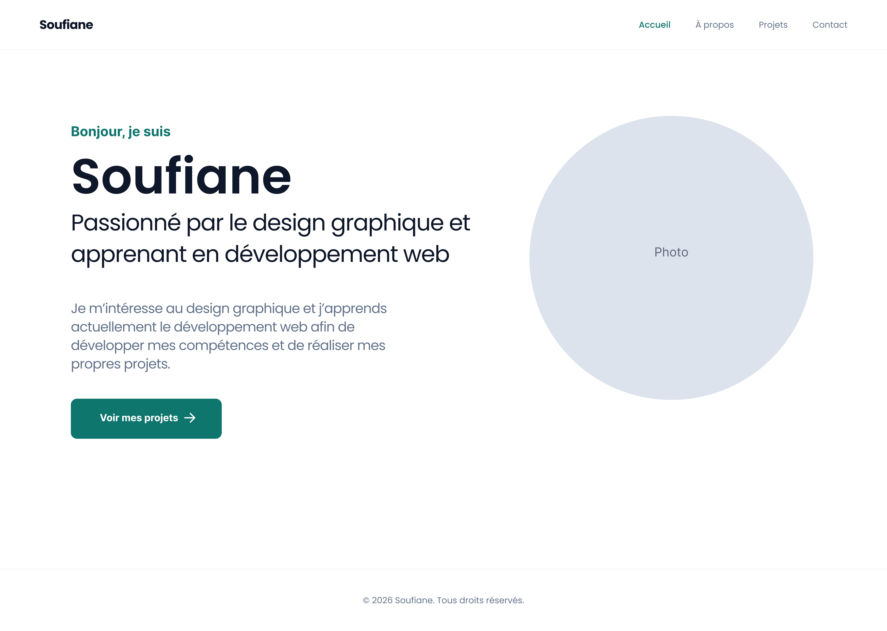
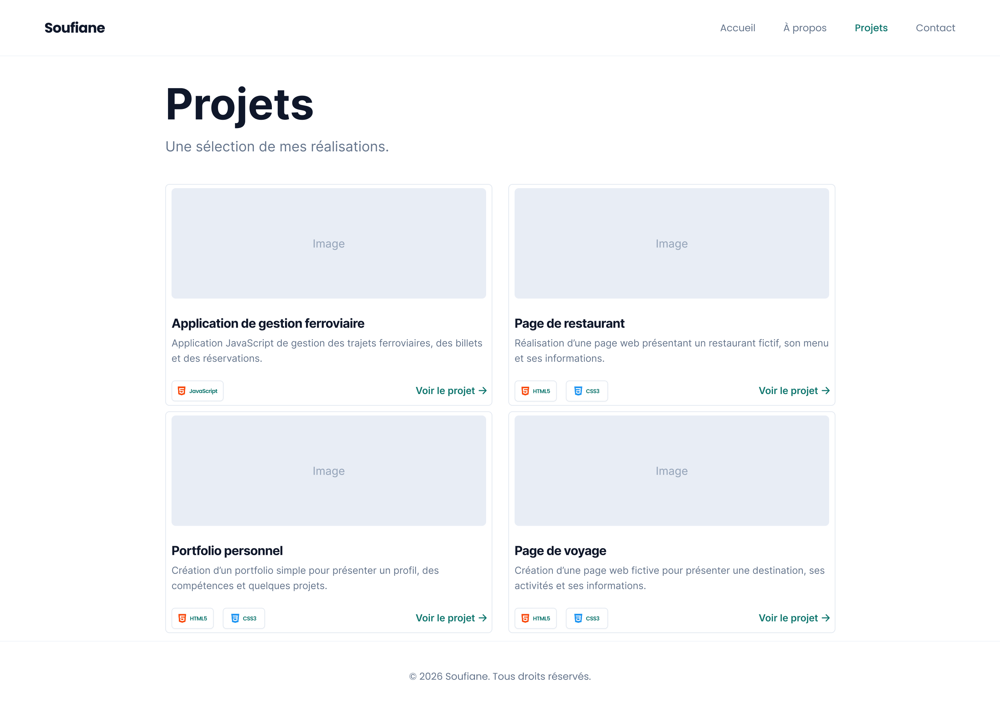
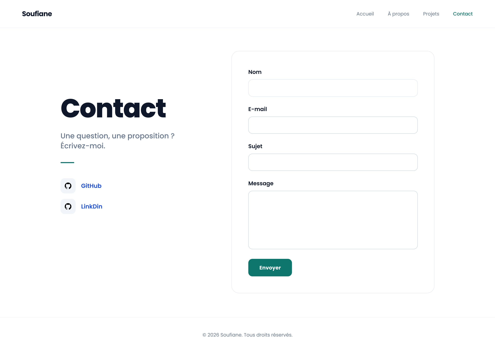

# Portfolio 

Portfolio Soufiane Amousse
Portfolio personnel réalisé en HTML5 et CSS3 dans le cadre du Brief 1.

## Lient Figma
[line figma]
(https://www.figma.com/design/d4Pr1BwADQdbwEKk3rpkFp/Untitled?node-id=0-1&t=OKPNMHxAiDEtAloO-1)

## Modifications apportées
- Remplacement du nom, des textes et de la photo par mes informations.
- Modification des couleurs, de la police et des espacements.
- Séparation du site en 4 pages : Accueil, À propos, Projets et Contact.
- Ajout de la page À propos avec mes compétences et mon parcours.
- Remplacement des projets d'exemple par mes propres projets avec images et descriptions.
- Modification des icônes et ajout des liens GitHub et LinkedIn.
- Mise en grille des projets avec CSS Grid.
- Ajout du champ Sujet dans le formulaire de contact.
## Maquette Figma

